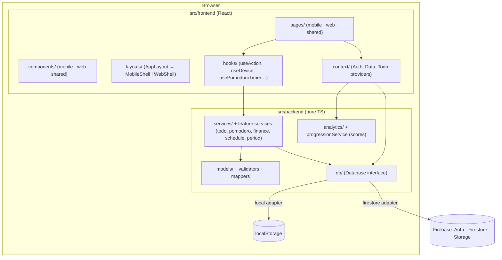
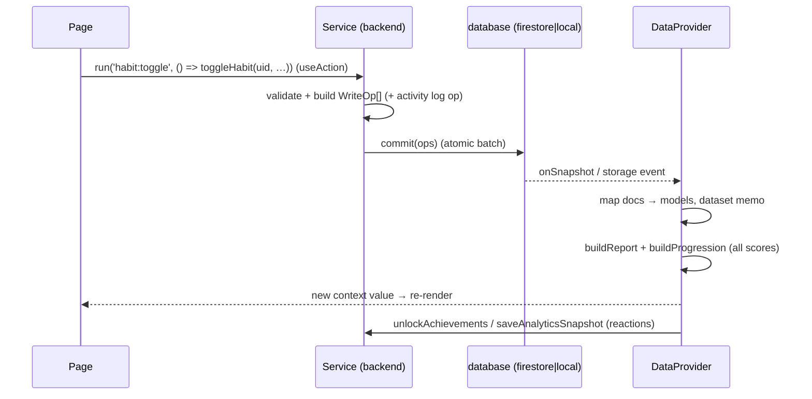
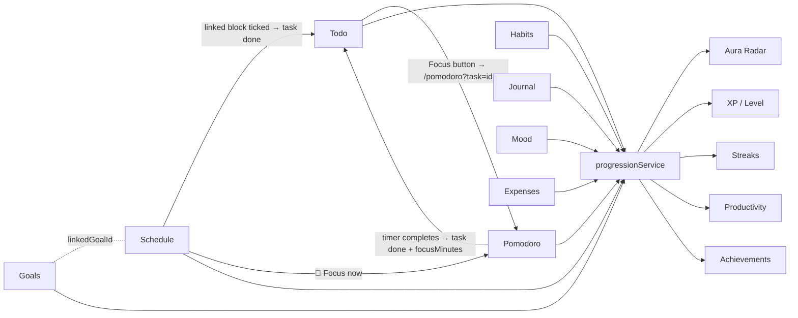

# Architecture

Aura Maxxing is a **client-only single-page app** (React 19 + TypeScript + Vite) backed by **Firebase** (Auth, Firestore, Storage, Analytics). There is no custom server: the "backend" is a layer of plain TypeScript modules in `src/backend/` that the UI calls, and Firestore security rules enforce ownership and data shape on the server side.



## Layering rules

| Layer                               | May import                                                                                                     | Must not                          |
| ----------------------------------- | -------------------------------------------------------------------------------------------------------------- | --------------------------------- |
| `src/backend/**`                    | other backend modules, Firebase SDK (only in `firebase/`, `db/firestoreDatabase.ts`, `auth/`, storage uploads) | React, anything in `src/frontend` |
| `src/frontend/context`              | backend (db, analytics, services)                                                                              | —                                 |
| `src/frontend/pages` / `components` | context hooks, `hooks/`, backend _types, pure analytics and services_                                          | Firestore SDK directly            |

The UI never calls Firestore. All writes go through a **service** that builds `WriteOp[]` and calls `database.commit()`.

## Frontend structure

- **Entry** — `src/main.tsx`: `StrictMode → AuthProvider → ToastProvider → DataProvider → App`. Applies the cached theme (`localStorage['aura-theme']`) before first paint.
- **Routing** — `src/app.tsx` (react-router 7). Public `/login`, `/register`; everything else under `<ProtectedRoute>` → `<AppLayout>`. Heavy pages are `lazy()` chunks (todo, analytics, health, pomodoro, expenses, schedule, trackers, profile, settings).
- **Shells** — `layouts/AppLayout.tsx` picks a shell by device (`useDevice`: tablet ≥ 768 px, desktop ≥ 1200 px):
  - `MobileShell` — top bar + the radial navigation wheel (`components/mobile/NavMenu`).
  - `WebShell` (lazy chunk) — `DesktopSidebar`, `DesktopTopbar`, `QuickActionsFab`, framer-motion transitions, `styles/web.css`.
  - `ResponsivePage({ mobile, web })` swaps a whole page per device (dashboard, analytics).
- **App-wide extras** (rendered inside the shell): `GenderPrompt`, `AchievementUnlocked` pop-up, `AppReminderRunner`, `ScheduleReminderRunner`, `PeriodReminderRunner` (female users).
- **Shared UI kit** — `components/shared/ui` (Card, Button, StatCard, Modal, SegmentedControl, Field, ProgressBar, Timeline, …) plus charts (`AuraRadar`, `TrendLine`, `TrendBars`, period charts) — presentation only.

## State management

No Redux/Zustand: **React context + real-time subscriptions**.



| Provider                                   | Holds                                                                                                                                                                                                 | Source                                                                             |
| ------------------------------------------ | ----------------------------------------------------------------------------------------------------------------------------------------------------------------------------------------------------- | ---------------------------------------------------------------------------------- |
| `AuthProvider` (`context/AuthContext.tsx`) | `user`, `profile`, `mode` (`firebase`/`local`), `gender`, auth actions                                                                                                                                | `onAuthChange` + `users/{uid}` doc; runs schema migration when `schemaVersion < 2` |
| `DataProvider` (`context/DataContext.tsx`) | All user collections (habits, logs, goals, journal, moods, activity, achievements, snapshots, tasks, pomodoro, expenses, income, schedule, settings) + derived `report`, `progression`, `logsByHabit` | One `database.subscribe` per collection; derived data in a single `dataset` memo   |
| `TodoProvider` (`context/TodoContext.tsx`) | Tasks, task activity, legacy focus sessions, task notifications, day stats, Todo XP/productivity                                                                                                      | Separate subscriptions (mounted inside `AppLayout`)                                |
| `ToastProvider`                            | Toast queue                                                                                                                                                                                           | —                                                                                  |
| `ScoreHistoryProvider`                     | `openHistory({ kind })` modal for every scoreboard                                                                                                                                                    | Reads `useUserData()`                                                              |

Hooks: `useUserData()`, `useAuth()`, `useTodo()`, `useScoreHistory()`, `useToast()` — each lives in its own `.ts` file so component files export only components (react-refresh rule).

**Reactions** in `DataProvider` after data changes: evaluate achievements → `unlockAchievements` (and emit `achievementEvents` for the pop-up); save one `analyticsSnapshots/{today}` per day when the radar signature changes; sync the theme to `<html data-theme>`.

**Local UI state** stays in components (`useState`), persisted to `localStorage` only where it must survive reloads (Pomodoro timer `aura-pomodoro-timer`, theme `aura-theme`, notification de-dup keys).

## Backend structure

| Module                                                                   | Responsibility                                                                                                                                                                                                                             |
| ------------------------------------------------------------------------ | ------------------------------------------------------------------------------------------------------------------------------------------------------------------------------------------------------------------------------------------ |
| `core/`                                                                  | `dates.ts` (ISO date math, local time), `errors.ts` (`ValidationError`, `toUserMessage`, `isTransientError`, `withRetry`), `ids.ts` (`newId`, `nowIso`)                                                                                    |
| `db/`                                                                    | `Database` interface + `paths`; `firestoreDatabase.ts` and `localDatabase.ts` adapters; `database` singleton chosen at startup                                                                                                             |
| `firebase/`                                                              | SDK init from `VITE_FIREBASE_*`; `isFirebaseConfigured`                                                                                                                                                                                    |
| `auth/authService.ts`                                                    | register / login (email or mobile) / Google / reset / logout; local accounts                                                                                                                                                               |
| `models/`                                                                | Domain types and constants (habits, goals, journal, mood, activity, preferences, radar)                                                                                                                                                    |
| `validators/`                                                            | Input validation that throws `ValidationError`                                                                                                                                                                                             |
| `repositories/mappers.ts`                                                | `toX(doc)` — sanitise untrusted stored docs into typed models with defaults                                                                                                                                                                |
| `services/`                                                              | Workflows that produce atomic `WriteOp[]` batches incl. activity log entries (`habitService`, `goalService`, `journalService`, `profileService`, `systemService`, `migrationService`, `ops.ts`) and **`progressionService`** (all scoring) |
| `analytics/`                                                             | `habits.ts`, `metrics.ts`, `radar.ts` (report), `auraInsights.ts`, `factors.ts`                                                                                                                                                            |
| `achievements/engine.ts`                                                 | Achievement definitions and tiers                                                                                                                                                                                                          |
| Feature folders `todo/`, `pomodoro/`, `finance/`, `schedule/`, `period/` | Each has `types.ts`, `model.ts` (mapper + validator), `analytics.ts` (pure), `*Service.ts` (writes)                                                                                                                                        |
| `api/index.ts`, `index.ts`                                               | Facade re-exporting services, types and helpers                                                                                                                                                                                            |

### Services pattern

```ts
// src/backend/finance/financeService.ts
export async function addExpense(
  uid: string,
  raw: ExpenseInput,
): Promise<void> {
  const input = validateExpense(raw); // throws ValidationError
  const now = nowIso();
  const id = newId();
  await commit([
    setOp(paths.expenses(uid), id, {
      ...input,
      createdAt: now,
      updatedAt: now,
    }),
    activityOp(
      uid,
      "expense-added",
      `Logged ${EXPENSE_CATEGORY_META[input.category].label} expense…`,
      id,
    ),
  ]); // one atomic batch, retried on transient errors
}
```

### Database adapters

- **Firestore** — `persistentLocalCache` with multi-tab manager (offline-first). `commit` splits into batches of 450 and races the server acknowledgement against `SERVER_ACK_TIMEOUT_MS = 4000`: writes are already applied to the local cache, so the UI never hangs on a slow or blocked network; fast failures such as `permission-denied` still throw.
- **Local** — each collection is one `localStorage` key `aura-db:users/{uid}/{collection}`; subscriptions are emulated with listener sets + the `storage` event for cross-tab sync. Used automatically when `VITE_FIREBASE_*` is missing, and in tests.

## Firebase integration

Auth (email/password + Google), Firestore (all user data under `users/{uid}/…`, plus `phoneIndex/{mobile}` for mobile login), Storage (avatars, task attachments), Analytics (production builds only). Details: [FIREBASE.md](FIREBASE.md), [AUTHENTICATION.md](AUTHENTICATION.md).

## Cross-feature integration



## Utilities and reusable pieces

- `hooks/useAction` — wraps a service call: pending key, success toast, error toast with **Retry** for transient errors; `withInlineErrors` for form validation.
- `hooks/useDevice`, `useResponsiveLayout`, `usePrefersReducedMotion` — `useSyncExternalStore` media queries.
- `hooks/usePomodoroTimer` — timestamp-based timer persisted in localStorage.
- `animations/` — `Reveal`, `useAutoReveal`, framer-motion variants (web only).
- `lib/` — navigation (`nav-items.ts`, `routes.ts`), design tokens, achievement stickers/events, emoji groups (`habitEmoji.ts`, lazy `emojilib`), `auraMeta.ts` (radar colours, sources, score bands).
- `components/shared/reminders/notify.ts` — browser notification delivery with per-device de-duplication.

## Testing

Vitest unit tests cover the backend only (pure functions + service workflows against the local adapter): `analytics.test.ts`, `auraInsights.test.ts`, `progression.test.ts`, `features.test.ts`, `workflows.test.ts`, `todo.test.ts`, `period*.test.ts`, `reminders.test.ts`. `isFirebaseConfigured` is forced to `false` in test mode.
