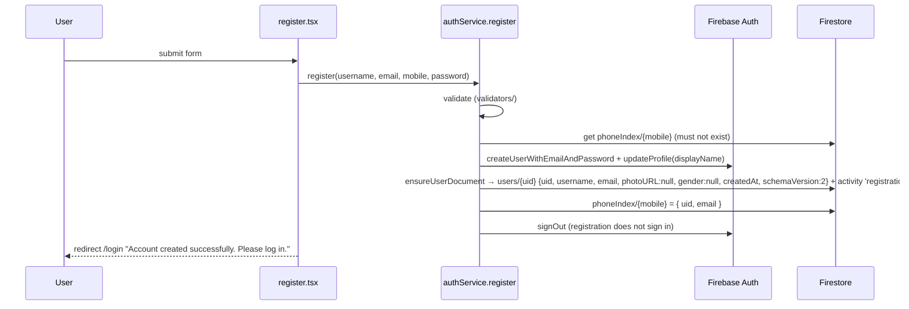

# Authentication

Code: `src/backend/auth/authService.ts` (logic), `src/frontend/context/AuthContext.tsx` + `useAuth.ts` (state), `src/frontend/layouts/ProtectedRoute.tsx` (guard), `src/frontend/pages/shared/auth/login.tsx` / `register.tsx` (UI), `src/backend/services/profileService.ts` (profile document).

Two modes, chosen at startup (`authMode`):

| Mode       | When                                                           | Accounts stored in                                     |
| ---------- | -------------------------------------------------------------- | ------------------------------------------------------ |
| `firebase` | All `VITE_FIREBASE_*` set (see [DEPLOYMENT.md](DEPLOYMENT.md)) | Firebase Authentication                                |
| `local`    | Firebase not configured, or tests                              | `localStorage['aura-local-accounts']` (salted SHA-256) |

## Registration

Fields: username (≤ 40), email, 10-digit mobile, password (≥ 8 chars with a letter and a digit), confirm password.



## Email / mobile login

`login(identifier, password)` — identifier is an email **or** a 10-digit mobile number. Mobile numbers are resolved to the email through `phoneIndex/{mobile}` (readable by id only, never listable). Then `signInWithEmailAndPassword`, `ensureUserDocument` (idempotent) and an activity entry `login`. On success the user is sent back to `location.state.from` or `/`.

## Google login

`loginWithGoogle()` — `signInWithPopup(googleProvider)` with `prompt: 'select_account'`; if the popup is blocked or unsupported (`auth/popup-blocked`, `auth/operation-not-supported-in-this-environment`) it falls back to `signInWithRedirect`. `finishGoogleSignIn` creates the profile document on first sign-in. The Google button is shown only in Firebase mode (`googleAvailable`). The Google provider must be enabled in the Firebase console (it is not declared in `firebase.json`, which lists only email/password).

## Password reset

`resetPassword(email)` → `sendPasswordResetEmail`. The UI always replies "If an account exists for that email, a reset link is on its way." (no account enumeration). Available in Firebase mode only.

## Session storage

- Firebase: `setPersistence(auth, browserLocalPersistence)` — the session survives browser restarts until logout.
- Local: `localStorage['aura-local-session']` holds the current user; accounts in `aura-local-accounts` (`{ uid: 'local_' + sha256(email)[0..20], email, mobile, username, salt, hash = sha256(salt + password) }`). Demo account `demo@aura.app` / `AuraDemo1` is shown on the login page in local mode.
- `logout()` signs out and the data subscriptions are torn down when `uid` changes.

## User profile creation

`ensureUserDocument(uid, { username, email, photoURL }, isNew)` writes `users/{uid}` only if it does not exist: `{ uid, username, email, photoURL, gender: null, createdAt, schemaVersion: 2 }`. `AuthProvider` subscribes to that document; if `schemaVersion < 2` it runs `migrateUserData(uid)` in the background (v1 habit dates → habit logs, legacy journals/moods split).

After login, `GenderPrompt` (modal) asks once for gender (Female / Male / Other-prefer-not-to-say). It can be changed later in Settings; `female` enables the Period & cycle tab and period reminders.

## Route protection

```tsx
// app.tsx (simplified)
<Route element={<ProtectedRoute />}>          // spinner while loading; <Navigate to="/login" state={{ from }} /> when signed out
  <Route element={<AppLayout />}>
    <Route path="/" … /> … all app pages
  </Route>
</Route>
<Route path="/login" … />                       // public; signed-in users are redirected to /
<Route path="/register" … />
```

- `loading` stays true until the session is resolved **and** the profile document has loaded, so pages never render without a profile.
- Data access is additionally enforced server-side: every Firestore path is `users/{uid}/…` with `isOwner(uid)` rules ([FIREBASE.md](FIREBASE.md)).

## Error handling

Firebase error codes are mapped to friendly messages (`auth/invalid-credential` / `wrong-password` / `user-not-found` → "Incorrect email or password", `email-already-in-use`, `weak-password`, `too-many-requests`, `network-request-failed`, popup closed/cancelled, `unauthorized-domain`, `operation-not-allowed`, `configuration-not-found`, `account-exists-with-different-credential`, Firestore `permission-denied` / `unavailable`). All public functions throw `AuthError` with that message.

## Security notes

- Passwords never touch Firestore; in local mode only salted hashes are stored (local mode is a single-device convenience, not a security boundary).
- `phoneIndex` rules: id must be 10 digits, keys only `uid`/`email`, `uid == auth.uid`, `email == auth.token.email`, no updates.
- Add every production domain to **Authentication → Settings → Authorized domains**, or Google sign-in fails with `auth/unauthorized-domain`.
