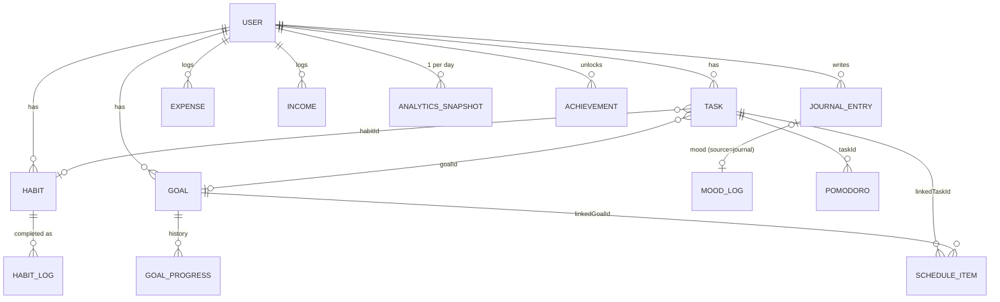

# Database Schema

Firestore (or the local adapter with the same paths). All timestamps are ISO 8601 strings (`createdAt`, `updatedAt`, …); all calendar dates are local `yyyy-mm-dd` strings (`date`, `dueDate`). Types live in `src/backend/models/index.ts` and the feature `types.ts` files; stored documents are sanitised on read by the mappers (`repositories/mappers.ts`, feature `model.ts`).

```
users/
└── {uid}
    ├── habits/            habitLogs/         goals/            goalProgress/
    ├── journalEntries/    moodLogs/          activityHistory/  analyticsSnapshots/
    ├── achievements/      settings/          periodLogs/
    ├── tasks/             taskActivity/      taskNotifications/ taskStats/   focusSessions/ (legacy)
    ├── pomodoro/          expenses/          income/           schedule/
    └── journals/, moods/  (schema v1 legacy, migration only)
phoneIndex/
└── {mobile}
```

---

## users/{uid} — UserProfile

| Field         | Type                                    | Notes                                                             |
| ------------- | --------------------------------------- | ----------------------------------------------------------------- |
| uid           | string                                  | Firebase Auth uid (immutable)                                     |
| username      | string                                  | ≤ 40 chars                                                        |
| email         | string \| null                          |                                                                   |
| photoURL      | string \| null                          | Storage URL or data URL (local mode)                              |
| gender        | `'male' \| 'female' \| 'other'` \| null | Asked once by `GenderPrompt`; `female` enables the period tracker |
| createdAt     | string                                  | Immutable                                                         |
| schemaVersion | number                                  | Currently **2**; lower triggers migration                         |
| migratedAt    | string                                  | Set by the v1 → v2 migration                                      |

## habits/{id} — Habit

| Field                | Type                                                      | Notes                                    |
| -------------------- | --------------------------------------------------------- | ---------------------------------------- |
| label                | string                                                    | ≤ 60, unique per user (case-insensitive) |
| category             | `health \| learning \| productivity \| mindset \| social` | Decides which radar factors it feeds     |
| priority             | `low \| medium \| high`                                   | Weight 1/2/3 in completion rates         |
| frequency            | `daily \| weekly`                                         | Weekly habits are due once per ISO week  |
| emoji                | string                                                    | ≤ 16; empty = category icon              |
| archived             | boolean                                                   | Archived habits stop counting as due     |
| createdAt, updatedAt | string                                                    |                                          |

## habitLogs/{habitId}\_{periodKey} — HabitLog

| Field     | Type   | Notes           |
| --------- | ------ | --------------- |
| habitId   | string | → habits        |
| date      | string | Completion date |
| createdAt | string |                 |

Deterministic id (period = day, or week start for weekly habits) prevents double completion.

## goals/{id} — Goal

| Field                | Type                                     | Notes                              |
| -------------------- | ---------------------------------------- | ---------------------------------- |
| title                | string                                   | ≤ 80                               |
| detail               | string                                   | ≤ 280                              |
| term                 | `short \| long`                          | XP 50 / 200 on completion          |
| dueDate              | string \| null                           |                                    |
| milestones           | number                                   | 1–50                               |
| milestoneNames       | string[]                                 | length = milestones, each ≤ 60     |
| milestonesComplete   | number                                   |                                    |
| progress             | number                                   | round(complete / milestones × 100) |
| status               | `not-started \| in-progress \| complete` | Derived from progress              |
| completedAt          | string \| null                           |                                    |
| createdAt, updatedAt | string                                   |                                    |

## goalProgress/{id} — GoalProgress (append-only)

| Field              | Type                                                                          | Notes                                         |
| ------------------ | ----------------------------------------------------------------------------- | --------------------------------------------- |
| goalId             | string                                                                        | → goals                                       |
| type               | `created \| milestone \| milestone-undone \| completed \| reopened \| edited` |                                               |
| progress           | number                                                                        | Snapshot %                                    |
| milestonesComplete | number                                                                        | Snapshot                                      |
| createdAt          | string                                                                        | Used to reconstruct progress at any past date |

## journalEntries/{id} — JournalEntry

| Field                | Type         | Notes                                                      |
| -------------------- | ------------ | ---------------------------------------------------------- |
| text                 | string       | ≤ 10,000                                                   |
| mood                 | Mood \| null | `happy \| energetic \| calm \| neutral \| low \| stressed` |
| tags                 | string[]     | ≤ 10, each ≤ 24, lowercase                                 |
| wordCount            | number       | Derived                                                    |
| date                 | string       |                                                            |
| createdAt, updatedAt | string       |                                                            |

## moodLogs/{id} — MoodLog

| Field          | Type                  | Notes                                                                      |
| -------------- | --------------------- | -------------------------------------------------------------------------- |
| mood           | Mood                  |                                                                            |
| score          | number                | 1–10 (default: happy 9, energetic 8, calm 7, neutral 5, low 3, stressed 2) |
| note           | string                | ≤ 280                                                                      |
| source         | `check-in \| journal` | Only check-ins earn XP                                                     |
| journalEntryId | string \| null        | When source = journal                                                      |
| date           | string                |                                                                            |
| createdAt      | string                |                                                                            |

## activityHistory/{id} — Activity

| Field     | Type           | Notes                                                                                                                                                                                                                                                                    |
| --------- | -------------- | ------------------------------------------------------------------------------------------------------------------------------------------------------------------------------------------------------------------------------------------------------------------------ |
| type      | ActivityType   | `login, registration, habit-created/updated/archived/deleted/completed, goal-created/updated/deleted/completed, milestone-completed, journal-created/updated/deleted, mood-logged, achievement-unlocked, profile-updated, data-exported, focus-completed, expense-added` |
| message   | string         | ≤ 300                                                                                                                                                                                                                                                                    |
| entityId  | string \| null |                                                                                                                                                                                                                                                                          |
| createdAt | string         |                                                                                                                                                                                                                                                                          |

## analyticsSnapshots/{yyyy-mm-dd} — AnalyticsSnapshot

| Field     | Type        | Notes                                                                 |
| --------- | ----------- | --------------------------------------------------------------------- |
| date      | string      | = doc id                                                              |
| scores    | RadarScores | `{ discipline, growth, wellness, focus, mindfulness, finance }` 0–100 |
| overall   | number      | Overall Aura                                                          |
| createdAt | string      |                                                                       |

Written at most once per day by `DataProvider` when the radar changes.

## achievements/{achievementId} — Achievement

| Field      | Type   |
| ---------- | ------ |
| unlockedAt | string |

The id is the definition id from `achievements/engine.ts` (see [AURA_SYSTEM.md](AURA_SYSTEM.md#6-achievements)).

## settings/{id}

**preferences** — Preferences

| Field                | Type            | Default |
| -------------------- | --------------- | ------- |
| theme                | `dark \| light` | dark    |
| habitReminder        | boolean         | false   |
| habitReminderTime    | `HH:MM`         | 19:00   |
| journalReminder      | boolean         | false   |
| journalReminderTime  | `HH:MM`         | 21:00   |
| browserNotifications | boolean         | false   |

**finance** — FinanceSettings

| Field          | Type                                                   | Notes                |
| -------------- | ------------------------------------------------------ | -------------------- |
| currency       | string                                                 | ≤ 4, default `₹`     |
| monthlyBudget  | number \| null                                         |                      |
| categoryLimits | `{ [ExpenseCategory]: number }`                        | Positive values only |
| savingGoals    | `{ id, name ≤ 40, target, saved, deadline \| null }[]` | ≤ 12                 |

**periodReminders** — ReminderSettings

| Field            | Type                                  | Default |
| ---------------- | ------------------------------------- | ------- |
| periodEnabled    | boolean                               | false   |
| periodDaysBefore | number 1–7                            | 2       |
| checkInEnabled   | boolean                               | false   |
| checkInTime      | `HH:MM`                               | 20:00   |
| custom           | `{ id, label ≤ 80, time, enabled }[]` | []      |
| showDetails      | boolean                               | false   |
| browser          | boolean                               | false   |

All settings docs also carry `updatedAt`.

## periodLogs/{yyyy-mm-dd} — DailyLog

| Field                                   | Type                                                               | Notes                          |
| --------------------------------------- | ------------------------------------------------------------------ | ------------------------------ |
| date                                    | string                                                             | = doc id                       |
| period                                  | `{ isPeriodDay, flow: spotting\|light\|medium\|heavy, pain 0–10 }` | optional                       |
| moods                                   | CycleMood[]                                                        | 12 cycle moods (happy … angry) |
| moodIntensity, energyLevel, stressLevel | number 1–5                                                         | optional                       |
| symptoms                                | `{ name ≤ 40, severity 1–5 }[]`                                    |                                |
| notes                                   | string                                                             | ≤ 2,000                        |

Empty logs are deleted rather than stored.

## tasks/{id} — Task

| Field                  | Type                                                 | Notes                                 |
| ---------------------- | ---------------------------------------------------- | ------------------------------------- |
| title                  | string                                               | ≤ 120                                 |
| description            | string                                               | ≤ 2,000                               |
| notes                  | string                                               | ≤ 5,000                               |
| status                 | `todo \| in-progress \| blocked \| done \| archived` |                                       |
| archivedFrom           | TaskStatus \| null                                   | Restore target                        |
| priority               | `low \| medium \| high \| critical`                  |                                       |
| tags                   | string[]                                             | ≤ 8, each ≤ 24                        |
| dueDate                | string \| null                                       |                                       |
| dueTime                | `HH:MM` \| null                                      | Only with dueDate                     |
| estimateMinutes        | number \| null                                       | 1–1440; used as the Pomodoro duration |
| recurrence             | `none \| daily \| weekly \| monthly`                 |                                       |
| recurrenceNextId       | string \| null                                       | Spawned next occurrence               |
| subtasks               | `{ id, title ≤ 120, done, completedAt }[]`           | ≤ 50                                  |
| attachments            | `{ id, name, size, type, url (https/data), path }[]` | ≤ 10                                  |
| dependsOn              | string[]                                             | Task ids                              |
| goalId, habitId        | string \| null                                       | Links                                 |
| focusMinutes           | number                                               | Credited by Pomodoro                  |
| startedAt, completedAt | string \| null                                       |                                       |
| createdAt, updatedAt   | string                                               |                                       |

## taskActivity/{id} — TaskActivity (append-only)

`taskId`, `taskTitle`, `type` (`created, status, priority, completed, reopened, edited, subtask, focus, deleted, archived, restored`), `from`, `to`, `message` (≤ 300), `createdAt`.

## taskNotifications/{id} — TaskNotification

`taskId`, `kind` (`due-1d \| due-1h \| overdue \| focus`), `title`, `body` (≤ 300), `read`, `createdAt`.

## taskStats/{yyyy-mm-dd} — TaskDayStats

`date`, `completed`, `created`, `focusMinutes`, `xp` (Todo XP: low 10, medium 20, high 35, critical 50), `streak`, `score`.

## focusSessions/{id} — FocusSession (legacy, append-only)

`taskId`, `taskTitle`, `mode` (`free \| pomodoro`), `startedAt`, `endedAt`, `minutes`, `distractions`, `date`. Read and shown as Pomodoro history (`fromLegacyFocus`, ids prefixed `legacy_`); new sessions go to `pomodoro`.

## pomodoro/{id} — PomodoroSession

| Field              | Type                                                                   | Notes                                        |
| ------------------ | ---------------------------------------------------------------------- | -------------------------------------------- |
| mode               | `focus \| deep \| custom \| task`                                      |                                              |
| category           | `study \| coding \| reading \| work \| exercise \| personal \| custom` |                                              |
| customCategory     | string                                                                 | ≤ 40                                         |
| notes              | string                                                                 | ≤ 500                                        |
| focusMinutes       | number                                                                 | Planned, 5–180                               |
| actualMinutes      | number                                                                 | 0–focusMinutes                               |
| breakMinutes       | number                                                                 | 1–60                                         |
| completed          | boolean                                                                | Stopped-early sessions are kept with `false` |
| distractions       | number                                                                 |                                              |
| taskId             | string \| null                                                         | Linked task                                  |
| taskTitle          | string                                                                 | Snapshot                                     |
| startedAt, endedAt | string                                                                 |                                              |
| date               | string                                                                 |                                              |
| createdAt          | string                                                                 |                                              |

## expenses/{id} — Expense

| Field                | Type                                                                                                                    | Notes                            |
| -------------------- | ----------------------------------------------------------------------------------------------------------------------- | -------------------------------- |
| amount               | number                                                                                                                  | 0 < x ≤ 100,000,000 (2 decimals) |
| category             | `food \| shopping \| travel \| bills \| entertainment \| medical \| education \| investments \| subscriptions \| other` |                                  |
| description          | string                                                                                                                  | ≤ 120                            |
| date                 | string                                                                                                                  |                                  |
| paymentMethod        | `cash \| card \| upi \| bank \| wallet \| other`                                                                        |                                  |
| createdAt, updatedAt | string                                                                                                                  |                                  |

## income/{id} — Income

`amount` (as above), `source` (≤ 60, required), `date`, `createdAt`, `updatedAt`.

## schedule/{id} — ScheduleItem

| Field                | Type                                                                            | Notes                                       |
| -------------------- | ------------------------------------------------------------------------------- | ------------------------------------------- |
| title                | string                                                                          | ≤ 80                                        |
| description          | string                                                                          | ≤ 500                                       |
| date                 | string                                                                          | First (or only) occurrence                  |
| start, end           | `HH:MM`                                                                         | end > start                                 |
| category             | `work \| study \| health \| meetings \| personal \| family \| finance \| other` | Colour-coded                                |
| priority             | `low \| medium \| high`                                                         |                                             |
| recurrence           | `none \| daily \| weekdays \| weekly`                                           |                                             |
| reminderMinutes      | number \| null                                                                  | 0–1440 before start                         |
| completedDates       | string[]                                                                        | Per-occurrence completion                   |
| skippedDates         | string[]                                                                        | Occurrences removed/moved out of the series |
| linkedTaskId         | string \| null                                                                  | Completing the block completes the task     |
| linkedGoalId         | string \| null                                                                  |                                             |
| createdAt, updatedAt | string                                                                          |                                             |

## phoneIndex/{mobile}

`uid`, `email` — written at registration so a 10-digit mobile number can be resolved to the account email at login. Publicly `get`-able by id, never listable.

## Relationships


