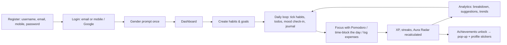

# Project Overview

## Vision

**Aura Maxxing** is a personal "Life OS": one place to build habits, reach goals, reflect, focus, plan the day, manage money and look after health — and to _see_ the result as an **Aura** that grows only through real, sustained behaviour.

## Purpose

Most trackers reward clicking buttons. Aura Maxxing rewards consistency:

- Every score (XP, level, streaks, the six-area Aura Radar, productivity) is **recalculated from history**, never incremented, so it cannot be farmed and always explains itself.
- Scores grow with **diminishing returns** — a new user with a perfect week is still early; months of steady effort reach the top.
- Every number is **clickable** and shows its history and the formula behind it.

## Main features

| Area         | Feature                                                             | Route        |
| ------------ | ------------------------------------------------------------------- | ------------ |
| Core         | Dashboard (mobile + desktop layouts)                                | `/`          |
| Core         | Todo (list, Kanban, calendar, timeline, analytics, achievements)    | `/todo`      |
| Core         | Habits (daily/weekly, categories, priorities, emoji, streaks)       | `/habits`    |
| Core         | Goals (short/long term, milestones, due dates, history)             | `/goals`     |
| Core         | Journal (mood, tags, search, stats)                                 | `/journal`   |
| Insight      | Analytics: Aura Radar centrepiece, trends, monthly & yearly reports | `/analytics` |
| Productivity | Pomodoro (25/5, 50/10, custom, task-linked)                         | `/pomodoro`  |
| Money        | Expenses (expenses, income, budgets, saving goals, alerts)          | `/expenses`  |
| Productivity | Daily Schedule (day/week/month time blocking, recurring, reminders) | `/schedule`  |
| Wellness     | Health Hub (mood, health habits, period & cycle tracker)            | `/health`    |
| Wellness     | Trackers (per-domain history and activity feed)                     | `/trackers`  |
| Account      | Profile (avatar, level, XP, streaks, achievement stickers)          | `/profile`   |
| Account      | Settings (theme, gender, reminders, notifications, export, delete)  | `/settings`  |

Cross-cutting: Firebase auth (email/mobile + password, Google) or a fully offline **local mode**, real-time sync, achievement pop-ups, reminders (habits, journal, schedule blocks, period), light/dark theme, responsive mobile/desktop shells.

## User journey

1. **Sign up** — username, email, 10-digit mobile, password (8+ chars with a letter and a digit). Then log in with email _or_ mobile, or Google.
2. **Personalise** — a one-time gender prompt (enables the period tracker for female users), theme, reminders.
3. **Daily loop** — complete habits, tasks and schedule blocks, check in on mood, journal, run Pomodoro sessions, log spending.
4. **Feedback** — XP and level on the profile, streak flame on the dashboard, achievement pop-ups, and the Aura Radar on Analytics with per-area reasons and concrete suggestions.

## Current status (2026-11-01)

- **Working end to end**: everything in the table above, in both Firebase and local mode, mobile and desktop.
- **Quality gates**: TypeScript strict, ESLint clean, 100 unit tests passing (`npx vitest run`), production build passing.
- **Version**: `package.json` is still `0.0.0`; only the original prototype is committed to git (see [CHANGELOG.md](CHANGELOG.md)).
- **Firebase project**: `aura-maxxing-cd7be` (`.firebaserc`). The Firestore database must exist and `firestore.rules` must be deployed for cloud mode (see [DEPLOYMENT.md](DEPLOYMENT.md)).
- Open issues and debt: [KNOWN_ISSUES.md](KNOWN_ISSUES.md). Next steps: [ROADMAP.md](ROADMAP.md).

## Documentation map

| File                                     | Read it for                                                       |
| ---------------------------------------- | ----------------------------------------------------------------- |
| [ARCHITECTURE.md](ARCHITECTURE.md)       | Layers, data flow, state management, diagrams                     |
| [FILE_STRUCTURE.md](FILE_STRUCTURE.md)   | What every folder and file does                                   |
| [FEATURES.md](FEATURES.md)               | Each feature: purpose, implementation, future work                |
| [AURA_SYSTEM.md](AURA_SYSTEM.md)         | **All score formulas** (radar, XP, levels, streaks, achievements) |
| [ANALYTICS.md](ANALYTICS.md)             | Metrics, charts, aggregation, trends                              |
| [FIREBASE.md](FIREBASE.md)               | Collections, rules, storage, real-time behaviour                  |
| [DATABASE_SCHEMA.md](DATABASE_SCHEMA.md) | Every collection and field                                        |
| [AUTHENTICATION.md](AUTHENTICATION.md)   | Login, Google, sessions, route protection                         |
| [DEPENDENCIES.md](DEPENDENCIES.md)       | Every package and where it is used                                |
| [DEPLOYMENT.md](DEPLOYMENT.md)           | Env vars, build, hosting, CI/CD                                   |
